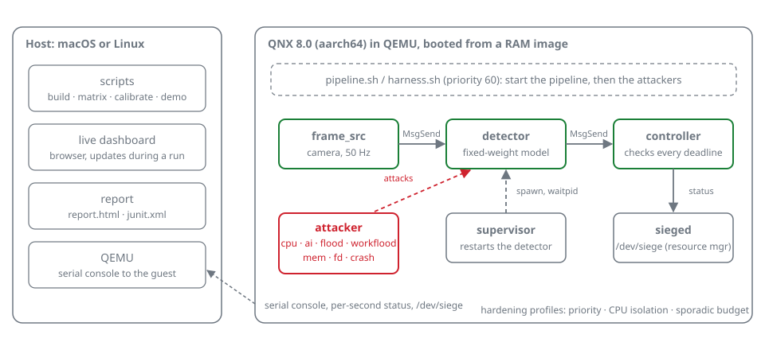
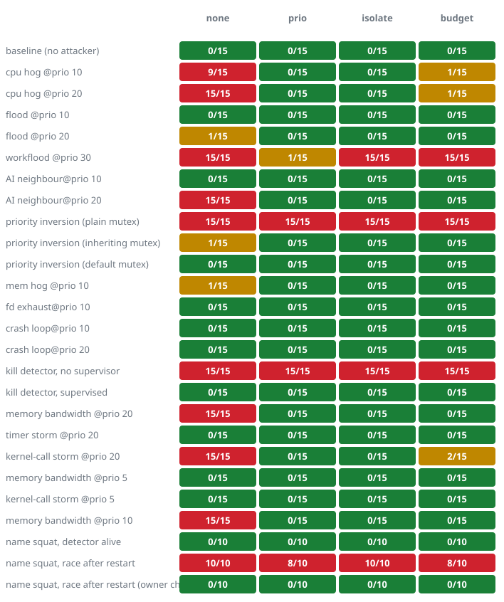
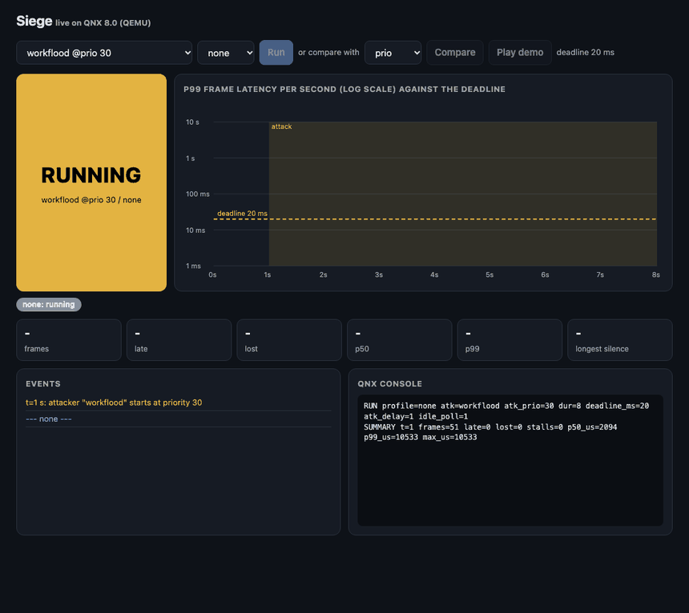

# Siege

Stress-testing for real-time isolation on QNX 8.0.

A real-time pipeline is only as safe as its worst neighbour. Siege runs a
camera-to-steering pipeline on QNX, attacks it with misbehaving processes
(a CPU hog, an inference-style compute neighbour, a message flood, a lock held
by a low-priority process, memory and descriptor exhaustion, a crash loop), measures every frame against its
deadline, and shows which QNX mechanisms restore the deadlines. The same
attack can be replayed with and without a hardening profile, so the effect of
each mechanism is measured, not assumed.

Siege produces stress evidence and regression tests. It does not certify
anything: passing runs show an isolation setup survived the attacks tried, not
that it is free from interference in general.



## The finding

**An attacker that uses 0.4% of the CPU broke the pipeline in 15 of 15 runs.**

A client at priority 30 sends the shared detector expensive requests. QNX serves
higher-priority senders first and runs the server at the priority of the client it
is serving, so the detector, whose own priority is 10, ran at 30 in 36 of 44
`pidin` samples while the pipeline's frames waited behind the flood. A kernel
trace of the same run shows the attacker using 0.4% of the CPU and the detector one
whole CPU ([`docs/trace-evidence.md`](docs/trace-evidence.md),
[`docs/mechanism-proof.md`](docs/mechanism-proof.md)). Failed runs out of 15:

| `workflood` at priority 30 | No hardening | Pipeline priority | Own CPU | CPU budget |
|---|---|---|---|---|
| Failed runs | **15/15** | 1/15 | **15/15** | **15/15** |

Giving the pipeline its own CPU, or capping the attacker's CPU, does nothing,
because the attacker is not taking CPU. The same pattern showed up in an unmodified
QNX service, the `pipe` manager (below).

### What each hardening setting protects

| Failure | `prio` (pipeline outranks the rest) | `isolate` (own CPU) | `budget` (CPU cap on the attacker) | What does fix it |
|---|---|---|---|---|
| CPU hog above the pipeline | fixes | fixes | fixes | any of the three |
| CPU hog at the same priority | fixes | fixes | fixes | any of the three |
| Flood of a shared service from a higher priority | **fixes** | does not | does not | only a higher pipeline priority |
| Lock held by a low-priority process (plain mutex) | does not | does not | does not | a priority-inheriting mutex; QNX's default already is one |
| A killed stage with no supervisor | does not | does not | does not | a supervisor (about 3 ms to recover) |
| Another process registers the service's name first after a restart | does not | does not | does not | the supervisor checking who owns the name and removing the impostor ([`docs/name-squatting.md`](docs/name-squatting.md)) |

Why: the CPU settings only limit who gets the CPU. The flood and the lock are not
CPU contention. They are queue-order and lock-ownership problems, and the setting
has to change who is served first or who inherits priority. Each row is measured in
the report below, under QEMU emulation, and "does not fix" means it failed in the
runs we did.

## What Siege found

<!-- results:start -->
Every scenario ran against every hardening profile (15 runs each;
5-second runs, 20 ms deadline). Failed runs out of total,
95% intervals in the report:

| Attack | No hardening | `prio` | `isolate` | `budget` |
|---|---|---|---|---|
| CPU hog at priority 20 | **15/15** | 0/15 | 0/15 | 1/15 |
| CPU hog at the same priority (10) | **9/15** | 0/15 | 0/15 | 1/15 |
| Name squatting after a restart | **10/10** | **8/10** | **10/10** | **8/10** |
| Same, supervisor checks the name's owner | 0/10 | 0/10 | 0/10 | 0/10 |
| `workflood` at priority 30 | **15/15** | 1/15 | **15/15** | **15/15** |
| AI neighbour at priority 20 | **15/15** | 0/15 | 0/15 | 0/15 |
| AI neighbour at the default priority | 0/15 | 0/15 | 0/15 | 0/15 |
| Priority inversion, plain mutex | **15/15** | **15/15** | **15/15** | **15/15** |
| Priority inversion, inheriting mutex | 1/15 | 0/15 | 0/15 | 0/15 |
| Detector killed, no supervisor | **15/15** | **15/15** | **15/15** | **15/15** |
| Detector killed, supervised | 0/15 | 0/15 | 0/15 | 0/15 |

* **A CPU hog above the pipeline's priority starves it for the whole attack**
  (the controller gave up after 3 s without a frame in 14 of 15 runs).
  Every profile restores it. **At the same priority it breaks the pipeline in
  about half the runs** (9 of 15). An early 5-run check passed all five,
  so treat the equal-priority case as unstable under emulation; see
  [`docs/more-attackers.md`](docs/more-attackers.md).
* **An attacker that uses almost no CPU still breaks it.** `workflood` sends a
  shared service expensive requests from a higher priority; QNX serves
  higher-priority senders first and runs the server at their priority. Only
  raising the pipeline's priority fixes it. Giving the pipeline its own CPU
  and capping the attacker's CPU do not.
* **An inference-style neighbour is harmless at the default priority and
  breaks about 15% of frames at a higher one.** All three profiles fix it.
* **A lock held by a low-priority process reproduces the Mars Pathfinder
  failure.** With a plain mutex the pipeline never recovered under any
  profile; only a priority-inheriting mutex fixes it, and QNX's default mutex
  already is one. Raising the pipeline's priority does not help.
* **A killed detector is never replaced without a supervisor.** With one it
  was serving again in about 3 ms (median).
* **Memory, descriptor and crash-loop attacks and a plain message flood did
  not break it** at the default priority (no failure in 5 runs each; that is
  "not observed", not "cannot happen").



**It is not only Siege's own detector.** A program whose latency goes through
QNX's own `pipe` manager ([`examples/pipeprobe`](examples/pipeprobe/), 5 ms
deadline, 5 runs each) shows the same queue-priority pattern in a real system
service. Failed runs out of total:

| Attack on a program that uses QNX's `pipe` manager | Probe at priority 10 | Probe at priority 40 |
|---|---|---|
| Pipe traffic at the same priority | 0/5 | 0/5 |
| Pipe traffic at priority 30 | 5/5 | 0/5 |
| CPU hog at priority 20 | 5/5 | 0/5 |

The same pipeline configured as a 30 Hz front-camera driver-assistance stack sharing a machine with lower-criticality software gives the same picture (9 scenarios, 4 profiles, 5 runs each, 36 of 36 matched their expectation): raising the pipeline's priority fixed everything observed, and a flood of the shared detector is the case that CPU affinity and CPU budgets do not fix. See [`docs/adas-isolation.md`](docs/adas-isolation.md), which also maps the findings to freedom-from-interference vocabulary and states what it does not show.

The same findings with the trained network as the detector (`DET_MODEL=cnn`,
5 runs each; [`examples/cnn/`](examples/cnn/)). The network found the object
correctly in 35544 of 35544 checked frames (100.00%), attacked or not:

| Attack (trained-network detector) | No hardening | `prio` | `isolate` | `budget` |
|---|---|---|---|---|
| CPU hog at priority 20 | 5/5 | 0/5 | 0/5 | 0/5 |
| `workflood` at priority 30 | 5/5 | 1/5 | 5/5 | 4/5 |
| AI neighbour at priority 20 | 5/5 | 0/5 | 0/5 | 0/5 |
| AI neighbour at the default priority | 0/5 | 1/5 | 0/5 | 0/5 |
| Detector killed, no supervisor | 5/5 | 5/5 | 5/5 | 5/5 |
| Detector killed, supervised | 0/5 | 0/5 | 1/5 | 0/5 |
<!-- results:end -->

The full table with a per-run drill-down is in
[`docs/report.html`](docs/report.html) ([Markdown](docs/report.md)); the raw
runs are in [`docs/results/`](docs/results/). To understand the results:

* [`docs/why-qnx.md`](docs/why-qnx.md): which findings depend on how QNX works
  and which would hold on any fixed-priority scheduler.
* [`docs/patterns.md`](docs/patterns.md): each finding as a named pattern with
  its symptom, cause, detection and fix.
* [`docs/test-report.html`](docs/test-report.html): the same evidence as a
  safety-style test record (numbered test cases, pass criteria, traceability,
  limits, sign-off). Evidence, not certification.
* [`docs/mechanism-proof.md`](docs/mechanism-proof.md): the `workflood` mechanism
  observed directly, by sampling the detector's priority while it is flooded.
* [`docs/landscape.md`](docs/landscape.md): how much priority margin the pipeline
  needs, measured.
* [`docs/trace-evidence.md`](docs/trace-evidence.md): a kernel trace of the flood:
  the attacker used 0.4% of the CPU, the detector one whole CPU.
* [`docs/README.md`](docs/README.md): an index of everything in `docs/`.
* The evidence table at the end of the report groups results by interference
  channel (execution time, memory, message exchange, kernel objects, process
  and service failure).

## See it run



```sh
scripts/live.py
```

boots the image in QEMU and serves a dashboard at `http://127.0.0.1:8766`.
Pick a scenario and a hardening profile and press Run, or press Play demo for
a scripted sequence. The page shows a status tile, per-second p99 latency on a
log scale against the deadline, the attack window, supervisor and outage
events, a plain-language verdict, and the raw QNX serial console. A starved
pipeline shows up as STALLED, because the controller cannot report while it is
starved. Scenarios and profiles come from `siege.json`, so your own appear in
the menus. (`--simulate` serves made-up data with a visible banner. It exists
only for testing the page.)

## Try it and tell us what you think

Siege has so far been used only by its author, so outside eyes are the most
useful thing it can get. If you work with QNX and have ten minutes:

```sh
git clone https://github.com/Siddhartha20242/siege-qnx && cd siege-qnx
./siege doctor        # checks QEMU, the QNX SDP and the build machine, and says how to fix what is missing
./siege build         # cross-compile and build the image
./siege live          # open http://127.0.0.1:8766, pick "workflood @prio 30", press Run
```

Then open an issue with the "I tried Siege" template: what worked, what
confused you, and whether you agree with the findings. If you have a real
board, [`docs/hardware.md`](docs/hardware.md) shows how to run the same tests
on it and share the result.

## Target

| | |
|---|---|
| OS | QNX SDP 8.0 (QNX Everywhere, non-commercial licence) |
| Target | aarch64le on QEMU `virt` (`-machine virt,gic-version=3 -cpu cortex-a57 -smp 2`, software emulation) |
| Toolchain | `qcc -Vgcc_ntoaarch64le` (GCC 12.2.0) |
| Host used | macOS on Apple Silicon (runs QEMU) plus an Ubuntu ARM VM running the x86 QNX host tools under Rosetta |

The project builds and runs on any host that can run the QNX SDP and
QEMU. On x86_64 Linux the VM step is unnecessary: run `make` and `mkifs`
locally.

## What runs on QNX

Three processes talk over native QNX message passing:

```
frame_src --MsgSend--> detector --MsgSend--> controller
```

* `frame_src` stamps a deterministic synthetic 32x32 frame every 20 ms (50 Hz)
  with its scheduled capture time.
* `detector` finds a moving object, in one of two modes. `filter` (the
  default) is a fixed 3x3 centre-surround kernel. `cnn` (`DET_MODEL=cnn`) is a
  small trained convolutional network, about 150 thousand multiply-adds per
  frame, whose weights come from [`tools/train_detector.py`](tools/train_detector.py)
  (PyTorch, seeded). The controller checks the network's answer against where
  the camera put the object, so a pipeline that is on time but wrong also
  fails.
* `controller` computes a steering command and measures capture-to-command
  latency for every frame. Frames later than the deadline (20 ms by default,
  from `calibrate.py`), frames that never arrive, and a silence longer than
  the recovery budget all count as failures.

`attacker` runs one of thirteen attacks against the live pipeline:

| Mode | Behaviour |
|---|---|
| `cpu` | Threads that spin and never block |
| `ai` | An inference-style neighbour: 40 ms of matrix multiplication every 100 ms. Not hostile; the damage comes from where it is scheduled. |
| `mem` | Allocates and keeps touching 300 MB |
| `flood` | Sends junk messages to the detector as fast as it can |
| `workflood` | Sends the detector requests that each cost real CPU |
| `pinv` | Priority inversion: a low-priority process holds a lock the pipeline needs while medium-priority hogs keep it from running. `PINV=none\|inherit` picks the mutex protocol |
| `pipeflood` | Pushes data through QNX's own `pipe` manager as fast as it can |
| `fd` | Exhausts file descriptors, channels and connections |
| `crash` | Spawns a child that segfaults, and restarts it immediately |
| `membw` | Streams through a 32 MB buffer per thread, far larger than the caches |
| `timerstorm` | Threads that wake every 100 microseconds and sleep again (a user-space stand-in for a noisy interrupt source) |
| `squat` | Registers the detector's own service name and never answers, to see what QNX does with a second claimant and who wins the race after a restart |
| `kcall` | Threads that only yield and read the clock, entering the kernel as fast as they can |

The last three are covered in [`docs/more-attackers.md`](docs/more-attackers.md).

Two more processes support the pipeline:

* `supervisor` starts the detector, restarts it when it dies, and prints how
  long each restart took. It can also kill the detector on a schedule, to test
  recovery (`KILL_AT=<seconds>`, with `SUPERVISE=1` to restart it).
* `sieged` is a resource manager that publishes the live status as
  `/dev/siege`. The controller pushes a status line to it every second over
  native message passing, and `cat /dev/siege` returns the latest one, for
  example `state=GREEN t=4 profile=none frames=49 late=0 ...`.

## Hardening profiles

Set with `PROFILE=` in `image/pipeline.sh`.

| Profile | QNX mechanism | Effect |
|---|---|---|
| `none` | Default round-robin, priority 10 for everything | Baseline |
| `prio` | Fixed priorities | Pipeline at 40, above its neighbours |
| `isolate` | CPU affinity (`on -C`) | Pipeline owns CPU 1; attackers are confined to CPU 0 |
| `budget` | `SCHED_SPORADIC` | Attackers are capped at 10 ms of CPU per 100 ms, even at a higher priority |

## Build and run

Prerequisites: QNX SDP 8.0 installed (free through QNX Everywhere), QEMU, and
SSH access to a Linux machine with the SDP if your host cannot run the QNX
tools directly. New to QNX on a Mac? The
[codelab](docs/codelab-qnx-on-apple-silicon.md) walks through the whole setup
from nothing: a free Ubuntu VM, the QNX SDP, cross-compiling a native program,
and booting it in QEMU.

```sh
./siege doctor                   # checks everything and says how to fix what is missing
./siege setup user@host          # the machine with the QNX SDP (skip it if the SDP is loaded in this shell)
./siege build                    # cross-compile and build build/siege.ifs
./siege live                     # the browser dashboard
./siege boot -n                  # or boot the image yourself; quit QEMU with Ctrl-A then x
```

`./siege --help` lists every command, and `./siege selftest` runs the tests for
the Python tooling. Each one passes its remaining arguments
to the script behind it in `scripts/`.

At the QNX prompt:

```sh
pipeline.sh 8                                   # clean run, 8 seconds
ATK=cpu ATK_PRIO=20 pipeline.sh 8               # attacked, no hardening
PROFILE=budget ATK=cpu ATK_PRIO=20 pipeline.sh 8  # attacked, hardened
```

Each run prints one line per second, then a `FINAL` summary and
`RESULT PASS` or `RESULT FAIL`.

Automated runs from the host:

```sh
./siege calibrate                                      # measure the noise floor, suggest a deadline
./siege test --profile none --json none.json           # every scenario in siege.json, repeated
./siege test --profile prio --json prio.json
./siege report none.json prio.json --out report        # report.md, report.html and two SVG charts
./siege demo                                           # the scenes as a typed terminal session
```

Scenarios, run counts, the deadline and the tolerance live in `siege.json`:
to test a new attack or fault, add an entry to its `scenarios` list.

`calibrate.py` runs the clean pipeline repeatedly with a very large deadline
and reports the worst frame it saw. On the setup used here, ten clean runs had
a median latency of 1.5 ms and a worst single frame of 12.2 ms, and it
recommended a 20 ms deadline, which is what the results use. The verdict also
tolerates a small late-frame budget (2%) instead of requiring zero misses,
because emulation produces rare isolated outliers.

`image/ram.build` finds the SDK through `${QNX_TARGET}` (set by
`qnxsdp-env.sh`) and the build output relative to the repository root, so it
needs no editing.

## Use it in CI

Each scenario can declare what it is expected to do under each profile in
`siege.json` (the default is PASS):

```json
{"label": "workflood @prio 30", "attacker": "workflood", "prio": 30,
 "expect": {"none": "fail", "isolate": "fail", "budget": "fail"}}
```

```sh
scripts/matrix.py --profile prio --json prio.json
scripts/junit.py prio.json --out junit.xml      # exit code 1 on any mismatch
```

`junit.py` writes JUnit XML and exits non-zero when a case does not match its
expectation, so a regression (an expected pass that now fails) and an
unexpected fix both break the build and get a human to look.
[`examples/ci/github-actions.yml`](examples/ci/github-actions.yml) shows it on
a self-hosted runner that already has the SDP.

## Testing your own program

Siege can attack any real-time program, not only the reference pipeline. The
generic launcher `image/harness.sh` starts your program, lets it settle for a
second, and then starts the attackers against it.

1. Build your program for QNX and add it to the image: copy
   `image/local.build.example` to `image/local.build` and list your binary
   there. `scripts/build.sh` appends it to `image/ram.build`.
2. Make it print the two lines Siege reads when it finishes:

   ```
   FINAL ... late=N lost=N stalls=N p50_us=N p99_us=N max_us=N
   RESULT PASS|FAIL
   ```

   Measure lateness against when each cycle was *due*, not when your code got
   to run, so that a starved program cannot hide its own starvation.
3. Describe the run in a config file: the command (`{dur}` is the run length),
   the profiles as environment variables your program reads, and the
   scenarios. [`examples/ticker/siege.json`](examples/ticker/siege.json) is a
   complete example.
4. Run it:

   ```sh
   scripts/matrix.py --config examples/ticker/siege.json --profile none --json none.json
   scripts/matrix.py --config examples/ticker/siege.json --profile prio --json prio.json
   scripts/report.py none.json prio.json --out report
   ```

**If you cannot change the program**, wrap it. `siegewrap` runs your command at a
chosen priority and, beside it, a canary task that measures how late it wakes
against when it was due. It also checks the program is still alive at the end or
exited with status 0, and prints the two lines Siege reads for you:

```json
{"pipeline": {"command": "siegewrap -d {dur} -p 10 -- ./your_program"}}
```

It sees scheduling pressure and crashes, not the program's own deadlines, message
queues or locks, so a pass means the program got the scheduling it needed, not that
its output was on time. [`examples/wrap/`](examples/wrap/) runs it against a plain
shell loop (no failures at baseline, 5/5 failed against a CPU hog at the same
priority, 0/5 at priority 40). `-x ms` adds a whole-job deadline for programs that are meant to
finish: [`examples/wrap/siege-job.json`](examples/wrap/siege-job.json) runs 200 calls of QNX's own `pidin`
(about 2.5 s) with a 6 s limit. With no hardening, 5/5 runs failed against a CPU hog at the same priority,
5/5 against one at priority 20 and 5/5 against a crash loop; at priority 40, 0/5 failed in every case. One of
five baseline runs also failed, probably the job's own load disturbing the canary at the same priority.

[`examples/ticker/ticker.c`](examples/ticker/ticker.c) is a second program, a
single 100 Hz periodic task with a 5 ms deadline, about seventy lines long.
Siege tests it with no changes to the attackers. It is more fragile than the
reference pipeline, which shows that the result is specific to each program
(failed runs out of three; report in [`examples/ticker/`](examples/ticker/)):

| Attack | Default priority | Ticker at priority 40 |
|---|---|---|
| CPU hog at the same priority | 3 / 3 | 0 / 3 |
| CPU hog at priority 20 | 3 / 3 | 0 / 3 |
| Crash loop at priority 20 | 3 / 3 | 0 / 3 |

The reference pipeline survived the crash loop, and the same-priority hog only
some of the time (see above). The ticker failed every time, because its deadline
is tighter and it has no slack.

## A second architecture, and the path to a PC

Siege also builds and runs for QNX on x86-64 (`make ARCH=x86_64 BIN=build/x86_64/bin`). The headline scenarios gave the
same pattern on an x86-64 QNX 8.0 system in QEMU as on aarch64, and the hardware installer and ssh transport were
exercised end to end against that target. That is emulation, not a PC: nothing has been booted on a physical machine.
[`docs/pc.md`](docs/pc.md) has the exact commands, the results, and what would need to change for a real PC.

## An optional learned monitor

`./siege test` with `MONITOR=1` runs a small neural network inside the controller, in a
thread above every other priority, that reads the first seconds of the run's latency
samples and predicts, before the run ends, whether it will fail and which pattern it is.
It is written from scratch: training in numpy with hand-written backpropagation
([`tools/train_monitor.py`](tools/train_monitor.py)), inference in plain C
([`pipeline/monitor.h`](pipeline/monitor.h), generated). It sees only latency, never the
attacker or the profile.

**It does not beat a hand-written rule online.** Scored on 500 fresh runs on QNX
([`docs/predictor-online.md`](docs/predictor-online.md)), with 3 seconds of evidence the
network reaches F1 0.86 and a plain rule (alarm on a silent second, over 2% late or lost
frames, or p99 over the deadline) reaches 0.94. Offline, tested on attack types held out of
training ([`docs/predictor.md`](docs/predictor.md)), the network was ahead at 3 seconds
(0.95 against 0.88), so that result did not carry over to live runs. What it does add is
naming the pattern: it named lock inversion and dead service correctly in 39 of 40 flagged
runs, and CPU starvation in 28 of 46. Treat it as an experiment, not a feature to rely on.

## Where QNX is used

* Native IPC: `name_attach`, `name_open`, `MsgSend`, `MsgReceive`,
  `MsgReply`, `MsgError` (`pipeline/*.c`)
* Bounded blocking calls: `TimerTimeout` on send, reply and receive
  (`pipeline/common.h`, `pipeline/controller.c`)
* Scheduling: `SCHED_RR`, `SCHED_SPORADIC`, `ThreadCtl(_NTO_TCTL_RUNMASK)`,
  `on -p`, `on -C` (`pipeline/attacker.c`, `pipeline/probe.c`,
  `image/pipeline.sh`)
* Kernel objects: `ChannelCreate`, `ConnectAttach`, `spawnl`
  (`pipeline/attacker.c`)
* Resource manager: `resmgr_attach`, `iofunc`, `message_attach` and
  `name_attach` on one dispatch loop, serving `/dev/siege`
  (`pipeline/sieged.c`)
* Process supervision: `spawnvp`, `waitpid`, `kill` (`pipeline/supervisor.c`)
* Boot image: custom `mkifs` buildfile with `startup-qemu-virt`,
  `procnto-smp-instr`, a startup script and the pipeline binaries, run
  entirely from RAM (`image/ram.build`)
* Locks and shared memory: `shm_open`, `mmap`, `pthread_mutexattr_setpshared`,
  `pthread_mutexattr_setprotocol` with `PTHREAD_PRIO_NONE` and
  `PTHREAD_PRIO_INHERIT`, for the priority-inversion scenario
  (`pipeline/attacker.c`, `pipeline/common.h`, `pipeline/detector.c`)
* Observation: `pidin` sampling of live priorities (`scripts/mechanism_proof.py`),
  and kernel event tracing with `tracelogger` on the instrumented kernel and the
  host `traceprinter` (`scripts/trace_capture.py`)
* Diagnostics: `slogger2`

## How the measurements are kept honest

* Frames are stamped with their scheduled capture time, so a starved camera
  shows up as latency instead of hiding itself.
* The pipeline starts first and is attacked while it is running. An attacker
  started before the camera can starve it before its first timestamp.
* Emulation adds about 3 ms to every wake-up of an idle virtual CPU. A
  priority-1 spinner per CPU keeps them awake without taking time from
  anything at priority 2 or above (`IDLE_POLL=1`, default). It lowers the
  median latency from about 5.6 ms to about 2 ms.
* Emulation also produces rare isolated outliers, so the verdict is a late
  frame budget (2% by default) rather than zero misses, and results are
  reported as failure rates over repeated runs, with 95% intervals.
* `SCENE=1` swaps the synthetic noise for crops of two real Creative Commons photographs; the detector still finds the object while it is the brightest thing in the frame, and the CPU-hog finding repeats ([`docs/real-images.md`](docs/real-images.md)).
* In `cnn` mode every detection is checked against ground truth, so a
  pipeline that meets its deadlines with wrong answers still fails.
* "No failure seen" is not "cannot fail". With 5 runs, zero failures is still
  consistent with a failure rate of up to 43%; the report says so.

## Limitations

* **Timing is emulated.** QEMU timing is not hardware timing, and this has not
  been run on real hardware. The large effects here (multi-second starvation,
  silences of hundreds of milliseconds) are far above the measured noise floor
  (the worst frame in ten clean runs was 12 ms), so which attacks break which
  setups is robust. Small latency differences between runs are not meaningful.
* **The input is synthetic on purpose.** Every run sees identical frames,
  which is what makes runs comparable. The workload is less of a stand-in than
  it was: `DET_MODEL=cnn` runs a trained network whose answers are checked, the
  `ai` attacker runs real matrix-multiply bursts, and Siege tests a second,
  unrelated program (`examples/ticker`). The network solves an easy task
  (finding a bright square in noise) and was checked on 100% of its frames; it
  is not a claim about real camera data.
* **Nothing has run on real hardware.** `docs/hardware.md` and `./siege hw`
  make it a one-command job on a QNX 8.0 board; the transport and installer
  were tested against a QNX 8.0 x86-64 system in QEMU ([`docs/pc.md`](docs/pc.md)),
  not a board. If you have one, please run it and share the result.
* **Outside use is still zero.** Only the author has run Siege. The "Try it"
  section above is how to change that.
* **No adaptive partitioning.** It is not part of the free SDP. The `budget`
  profile uses `SCHED_SPORADIC` per-thread CPU budgets instead.
* **Run counts.** Most scenarios ran 5 times per profile and the headline
  and equal-priority scenarios 15 times. The report shows 95% Wilson intervals.
* **Programs under test** must be added to the image with `image/local.build`. They
  either print the `FINAL` and `RESULT` lines described above, or are run through
  `siegewrap`, which can only observe scheduling and liveness.

## Licence

MIT. See `LICENSE`.
