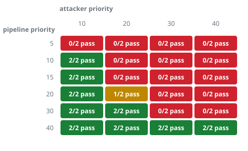
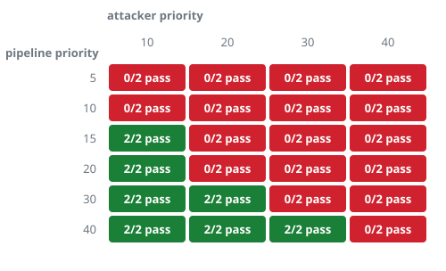

# Priority landscape

How much priority does the pipeline need? Each cell is the pipeline configured at one priority (rows) against an
attacker at another (columns); 2 runs of 4 s each, 20 ms deadline. Green: every run passed.
Red: none did. Amber: mixed. Measured in QEMU emulation, so read the shape, not single cells.

## CPU hog

* Pipeline **above** the attacker: 14 of 14 runs passed.
* Pipeline at the **same** priority: 5 of 8 runs passed.
* Pipeline **below** the attacker: 0 of 26 runs passed.

## message flood to the shared detector

* Pipeline **above** the attacker: 14 of 14 runs passed.
* Pipeline at the **same** priority: 0 of 8 runs passed.
* Pipeline **below** the attacker: 0 of 26 runs passed.

## What it shows

* **CPU hog.** Above the attacker's priority the pipeline was safe (14 of 14 runs); at the same priority it was mostly safe (5 of 8); below it, not safe (0 of 26).
* **Message flood to the shared detector.** Above the attacker's priority the pipeline was safe (14 of 14 runs); at the same priority it was not safe (0 of 8); below it, not safe (0 of 26).

**Note (added later):** a 15-run check of the reference pipeline at equal priority against a CPU hog failed 8 of 15 runs, and 11 of 15 in a repeat, so the equal-priority CPU cell below is unstable under emulation; see `more-attackers.md`.

The boundary is where the pipeline's priority crosses the attacker's, and the **same-priority row is the interesting one**. Against a CPU hog, equal priority is mostly safe, because round-robin scheduling shares the CPU between equals. Against a flood of a shared service, equal priority is not safe. A likely reason, which these runs do not isolate: messages at one priority are served in the order they arrive, and a client that never stops sending is always ahead in the queue. So the margin the pipeline needs depends on the failure mode, and for a shared service the relevant priority is that of **every client of that service**, not only of processes that look like attackers.
